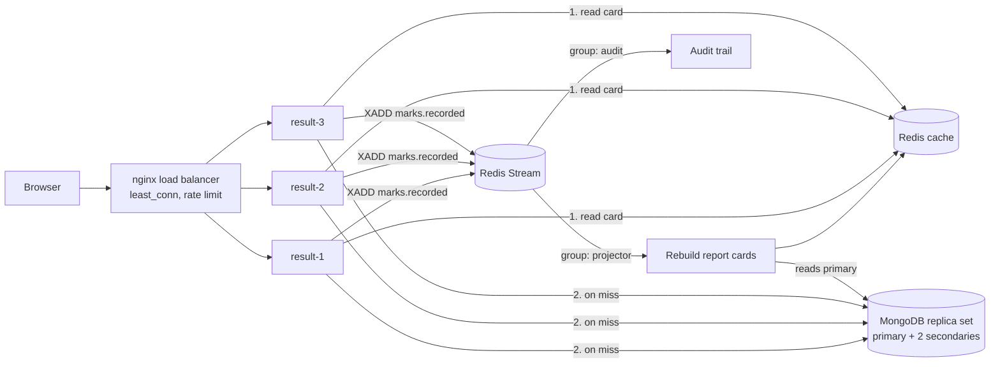

# Result Service

Event-driven result system for the school portal. Teachers record **midterm** and **final** marks
(out of any total they choose), students read their report card. Built to stay fast when a whole
school opens the results at the same minute.



## How it works

1. **Write path (command).** A teacher saves a marks sheet. The service checks the teacher is assigned
   to that exact subject of that class, validates `0 <= marks <= total`, writes to MongoDB (primary), then
   publishes a `marks.recorded` event to a Redis Stream.
2. **Events.** Two independent consumer groups read the stream. `result-projector` rebuilds the affected
   students' report cards in Redis (cache warming), `result-audit` stores an audit trail. Inside a group an
   event goes to exactly one instance; unacknowledged events are re-claimed, so delivery is at-least-once
   and handlers are idempotent.
3. **Read path (query).** `GET /api/results/me` reads the card from Redis. On a miss it is built from a
   MongoDB **secondary** and cached (TTL with jitter). If Redis is down, reads fall back to MongoDB.
4. **Result day.** nginx spreads requests over 3 stateless instances (`least_conn`, failed instances are
   skipped), rate-limits per client, and MongoDB reads are spread over the replica set.

## Run it

```bash
cd school-admin-backend/result
docker compose up --build        # API entrance: http://localhost:5100
```

Then:
- In `school-admin-backend/.env` set `MONGO_URI=mongodb://127.0.0.1:27017/school_admin?directConnection=true`
  and restart the main backend (it must use the same database as the result service).
- In `school-admin-frontend/.env.local` add `NEXT_PUBLIC_RESULT_API_URL=http://localhost:5100/api`.
- `JWT_SECRET` must be identical in both backends.
- Stop any local `mongod` first: the compose primary uses port 27017.

Without Docker (single instance): start MongoDB and Redis yourself, then `yarn install && yarn dev`.

## API (all require the login token)

| Method | Route | Role |
| --- | --- | --- |
| GET | `/api/results/me` | student |
| GET | `/api/results/teacher/assignments` | teacher |
| GET | `/api/results/teacher/sheet?classId&subjectId&exam` | teacher |
| PUT | `/api/results/teacher/marks` | teacher |

## Try the resilience

```bash
docker compose stop result-2     # nginx keeps serving from result-1 and result-3
docker compose stop redis        # results still load, straight from MongoDB
docker compose stop mongo1       # a secondary is elected primary; result service keeps working
npx autocannon -c 200 -d 20 -H "Authorization: Bearer <student token>" http://localhost:5100/api/results/me
```

The student result page shows which instance served the request and whether it was a cache HIT or MISS.

## Scaling and production notes
- More capacity: add `result-4` in `docker-compose.yml` and one `server` line in `nginx.conf`.
- Enable MongoDB auth and a replica set keyfile, and put TLS in front of nginx.
- The main backend's direct connection to `mongo1` is for local development only.
